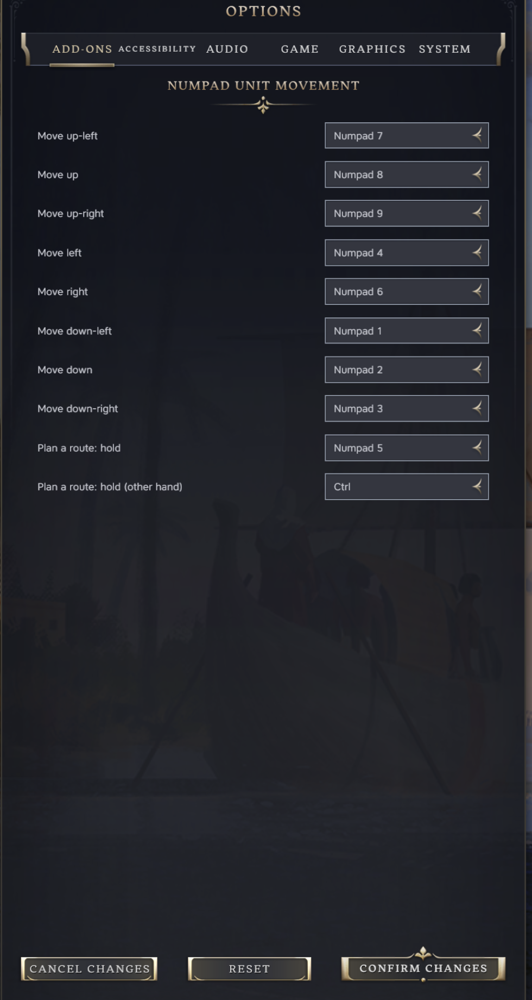
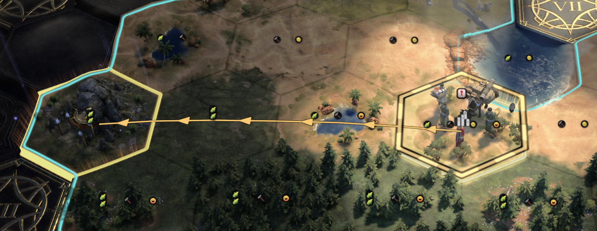
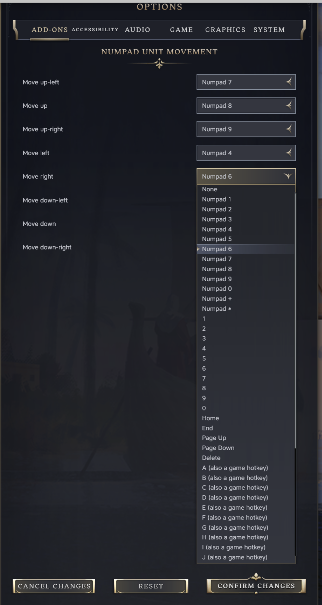

# Numpad Unit Movement

A Civilization VII mod. Move the selected unit one tile at a time with the number pad, for players on a laptop
trackpad or anyone who would rather not click. The keys can be changed in Options.

## What it does

- With a unit selected, a number pad key moves it one tile in that direction: 7 up-left, 8 up, 9 up-right, 4 left,
  6 right, 1 down-left, 2 down, 3 down-right.
- Each press is exactly a right-click on that tile, through the game's own code. Moving, attacking, swapping places
  with your own unit and the declare-war prompt all behave as a click would.
- Hold Numpad 5, or Ctrl for the other hand, and the same keys walk a marker across the map instead; the game draws
  the route and turn count as you go. Release the key and the unit is sent there, across several turns if needed,
  exactly as a right-click on that tile would. Escape while holding drops the route.
- Every key, the eight directions and the two hold keys, can be changed in Options > Add-ons, and the choice is
  kept between games.

## What it does not do

- It does not change gameplay, units, movement points or rules, and it writes nothing into a save. It can be added
  to or removed from any game.
- It does not take keys away from the game or from other mods, and it does not touch the mouse, the camera keys
  (arrows, W A S D) or a gamepad.
- It does not move a unit while the game is asking you to pick a tile (ranged attack, Move To, placing a building),
  while a screen or menu is open, or while you type.
- It does not find paths itself: the route goes to the game as one right-click on the destination, and the game's
  own pathfinding takes it from there, with the same limits as a mouse order (a unit that is already carrying out
  an order refuses a new one until it finishes).
- It does not add new hotkeys to the game's Keyboard Mapping screen; the keys are set on the mod's own rows under
  Options > Add-ons.

## Using it

Select a unit and press a number pad key:

| Key | Moves the unit |
| --- | --- |
| 7 | up-left |
| 8 | up |
| 9 | up-right |
| 4 | left |
| 6 | right |
| 1 | down-left |
| 2 | down |
| 3 | down-right |

- Each press is a right-click on the neighbouring tile, so everything a right-click does still happens: moving,
  attacking a unit or city there, swapping places with your own unit, and the prompt before an attack that would
  declare war.
- The map is made of hexes, so a tile has no neighbour straight above or below it. 8 and 2 step to the upper (or
  lower) tile in the unit's own column, which alternates left and right, so pressing 8 again and again travels
  straight up the screen.
- The unit stays selected while it has moves left, so you can keep pressing. When it runs out, the game moves on to
  the next unit as it normally does.
- Holding a key down does not repeat: one press, one tile.
- Keys work only on the map with a unit selected. They do nothing while you type in a text box (chat, renaming a
  city), while a screen or menu is open, or while the game is asking you to pick a tile (a ranged attack target,
  where to place a building, the Move To order).
- The mod never takes a key away from the game or from other mods: they see every key press as before. The mouse,
  the camera keys (arrows, WASD) and a gamepad are not touched: the mod reads keyboard presses only, and the gamepad
  goes through the game's input actions, which it never handles.

## Planning a route

Hold Numpad 5 and press direction keys: a marker walks across the map from the unit, one tile per press, and the
game draws the dotted path and turn count to it, as it does while a right-click is held. Release Numpad 5 and the
unit sets off; the game pathfinds the route and carries on over later turns if it has to. Ctrl does the same for
the other hand. Escape while holding drops the route; so does releasing with the marker back on the unit's tile.

## Changing the keys

Options > Add-ons > Numpad Unit Movement has one row per direction and one for each hold key. Each row offers the number pad digits, + and *,
the number row, Home, End, Page Up, Page Down, Delete, and the letters. Letters are marked "(also a game hotkey)": the game still does its own action for those keys, so pick one only if you have
moved that game hotkey elsewhere. Choose "None" to switch a direction off. A change applies to the next key press,
in the main menu or during a game.

If two directions are given the same key, the first one in the list wins. The hold keys offer Ctrl, Shift and Tab
as well as the keys above; Shift carries a note because on Windows it makes the number pad send Home, the arrows
and so on, which still steer the marker but also pan the camera.

## Other mods

Checked against the 13 other Tower mods and the 57 Workshop mods installed here, by reading their code. In game it
ran alongside the Tower mods and with every other mod switched off. Nothing else that was enabled uses the number pad.

- **Map Trix** (bz-map-trix) binds number pad 0 to 7 and minus to its lenses. With both mods on, one key switches a
  lens and moves the unit. Move this mod's keys elsewhere in Options, or Map Trix's in its own settings.
- **PD Building Labels** and **Chronicle** (ozq-chronicle) can swallow keys they use before other mods see them;
  Chronicle only while its own screens are open. A key either of them takes will not move a unit.
- **Demographics**' storage repair button clears every mod's saved settings, these keys included. After using it,
  set the keys again if you had changed them.

## Install

Download `numpad-unit-movement-v<version>.zip` from the
[latest release](https://github.com/tmtmiller1/civilizationvii_numpad-unit-movement/releases/latest) and unzip it
into the game's `Mods` directory, so that `Mods/numpad-unit-movement/numpad-unit-movement.modinfo` exists. Then
enable Numpad Unit Movement in the game's mod settings.

The `Mods` directory is `%LOCALAPPDATA%\Firaxis Games\Sid Meier's Civilization VII\Mods` on Windows and
`~/Library/Application Support/Civilization VII/Mods` on a Mac. It changes nothing in a save, so it can be turned on or off at any
time.

Made for Civilization VII 1.5.0.

## Known limits

- With Num Lock off, a Windows number pad sends Home, End, the arrow keys and so on instead of digits. Turn Num Lock
  on, or bind the directions to those keys in Options. The arrow keys pan the camera in the unmodded game and are not
  offered.
- Tested on a Mac only. On Windows the game builds its key events its own way, and that has not been watched.

## How it works

`ui/numpad-unit-movement.js` listens for key presses in the capture phase (with a unit selected, the game stops key
events before they bubble up to the window), looks up the direction for the key, finds the neighbouring
tile with `GameplayMap.getAdjacentPlotLocation`, and hands that tile to the game's own right-click handler
(`WorldInput.doActionOnPlot`). It checks the same conditions the game checks before a right-click on the map.

`ui/numpad-keys.js` turns a key press into a direction and is the part the unit tests cover. `ui/numpad-settings.js`
holds the default keys and reads and writes the player's choice in the shared `modSettings`
store. `ui/numpad-options.js` adds the Options rows. `ui/settings-keeper.js` is the Tower Settings Keeper file,
unchanged, which keeps that store readable so the keys survive a restart.

## Test record

Game 1.5.0 on a Mac, seeded Play Now game (seed 4242), Tower's usual mod set enabled, 2026-10-13.

Real key presses, sent through macOS with `devtools/keypad.swift` and `devtools/real-keys.sh` (the same events a
physical number pad produces):

- All eight number pad keys moved the settler one tile in the expected direction on screen. 8 and 2 alternated
  between the two upper (or lower) tiles in the unit's column; one 8 did not move because that tile was coast.
- The number row 6 did nothing.
- Number pad 0 to 9, + and * started no game action, and G still toggled the grid with the mod on.
- The same direction test, G and the Options rows passed with every other mod switched off (only the base game
  and its DLC loaded).
- Camera panning is untouched: with a unit selected, the arrow keys and W, A, S, D each moved the camera about 100
  world units and left the unit where it was; number pad 6 and 4 moved the camera 0.
- The mouse is untouched (`devtools/mouse.swift`, real mouse events): hovering put the plot cursor on the tile under
  the pointer, a left-click selected the unit (8 of 8 clicks sent), a right-click on the next tile moved it and kept
  it selected, and both still worked after a number pad move in between. The game clears the selection when a move
  spends the unit's last movement points, with the mouse or the number pad alike.
- What the game's UI receives differs from a browser: number pad 7 arrives as code `NumPad7`, key `g`, key code 103,
  location 0. The number pad . arrives as `NumpadSubtract` and - with no code, so neither is offered. Home, End,
  Page Up, Page Down, Delete, `Digit6` and `KeyG` arrive with standard codes; ; arrives as `SemiColon`, so
  punctuation is not offered.

Route planning (0.2.0), real key presses through macOS:

- Holding Numpad 5 and pressing 4 three times put the marker three tiles west with the game's path preview drawn;
  releasing sent the settler, which moved as far as its points allowed (two tiles) and kept the rest of the route
  queued for the next turn. Holding Ctrl and pressing 9 twice did the same toward the up-right.
- Numpad 5 and Ctrl each send a key-down and a key-up the game passes on, and the keypad digits arrive unchanged
  while either is held. Backquote sends no key-down and Caps Lock sends nothing, so neither is offered.
- Events sent into the page: Escape while holding dropped the route, with the preview cleared and the unit still.
  A unit that is still carrying out an earlier multi-turn order refused a new one, through the game's own
  `canStart` check, exactly as a right-click would.

Events sent into the page with `devtools/step.sh` and by hand, with the fields the game sends:

- With a unit selected the unit moved; in the Move To targeting mode, and with no unit selected, it did not.
- With a text box focused, number pad 4 did not move the selected unit.
- The game's log showed no errors or warnings from the mod.
- Options > Add-ons showed the eight rows with their default keys. Setting "Move right" to Home and confirming saved
  the choice; Home then moved the unit right and number pad 6 did nothing.

Not yet watched: Windows, and the keys surviving a restart. Once, after the Mac Help key was sent, no key reached
the game's UI until the game was restarted; the cause is not known.

## Licence

MIT.
