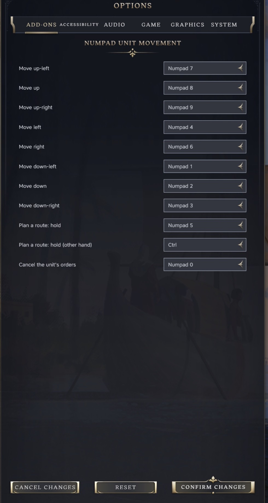
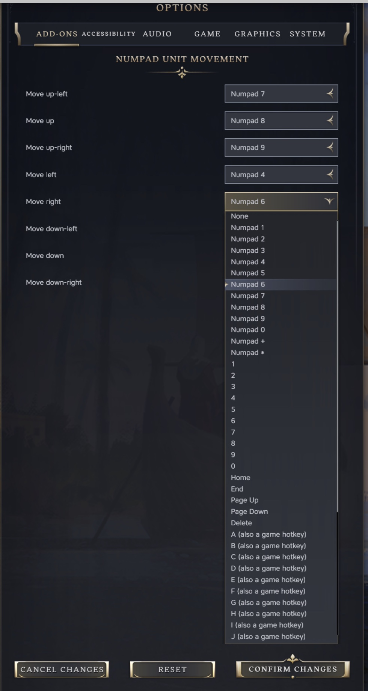

# Numpad Unit Movement

A Civilization VII mod. Move the selected unit one tile at a time with the number pad, for players on a laptop
trackpad or anyone who would rather not click. The keys can be changed in Options.

## How it works

- Select a unit and press a number pad key, and it moves one tile that way: 7 up-left, 8 up, 9 up-right, 4 left,
  6 right, 1 down-left, 2 down, 3 down-right.
- Hold Numpad 5, or Ctrl for the other hand, and the same keys walk a marker across the map instead, with the
  game's route and turn count drawn as you go. Let go and the unit sets off, carrying on over later turns if it
  has to. Escape while holding drops the route.
- Numpad 0 cancels the unit's current order, like the Cancel button on its action bar.
- Every press is a right-click on that tile, through the game's own code, so attacking, swapping places with your
  own unit and the declare-war prompt all work as they do with the mouse.
- Any of the keys can be changed in Options > Add-ons, and your choices are saved.

## Good to know

- Your saves and the game's rules are untouched, so you can switch the mod on or off in the middle of a game.
- The game and other mods still get every key press, and the mouse, the camera keys (arrows, W A S D) and gamepads
  work as before.
- The keys only work on the map with a unit selected. In menus, while you're typing, or while the game is asking
  you to pick a tile (a ranged attack, Move To, placing a building), they're ignored.
- Routes use the game's own pathfinding: the mod hands over the destination, the game finds the way, with the same
  limits as a mouse order. A unit that's already carrying out an order has to finish, or be cancelled with Numpad
  0, before it takes a new one.
- The keys are set on the mod's own rows under Options > Add-ons, so you'll find them there rather than on the
  game's Keyboard Mapping screen.

## Using it

Select a unit and press a number pad key:

| Key | Moves the unit |
| --- | --- |
| 7 | up-left |
| 8 | up |
| 9 | up-right |
| 4 | left |
| 6 | right |
| 1 | down-left |
| 2 | down |
| 3 | down-right |

- Each press is a right-click on the neighbouring tile, so everything a right-click does still happens: moving,
  attacking a unit or city there, swapping places with your own unit, and the prompt before an attack that would
  declare war.
- The map is made of hexes, so a tile has no neighbour straight above or below it. 8 and 2 step to the upper (or
  lower) tile in the unit's own column, which alternates left and right, so pressing 8 again and again travels
  straight up the screen.
- The unit stays selected while it has moves left, so you can keep pressing. When it runs out, the game moves on to
  the next unit as it normally does.
- One press, one tile; holding a key down doesn't repeat.
- A key pressed while Shift, Ctrl, Alt (Option) or Cmd is held is left to the game and other mods, so Shift+E and
  the like keep their own meaning. A modifier you've set as a route key is the exception: holding it plans a route.
- The keys work on the map with a unit selected. In a text box (chat, renaming a city), in a menu, or while the
  game is asking you to pick a tile, they're ignored.
- The game and other mods still get every key press. The mod reads keyboard presses only, so the mouse, the camera
  keys (arrows, WASD) and a gamepad work as before.

## Planning a route

Hold Numpad 5 and press direction keys: a marker walks across the map from the unit, one tile per press, and the
game draws the dotted path and turn count to it, as it does while a right-click is held. Release Numpad 5 and the
unit sets off; the game pathfinds the route and carries on over later turns if it has to. Ctrl does the same for
the other hand. Escape while holding drops the route; so does releasing with the marker back on the unit's tile.

A unit on a multi-turn route keeps going at the start of each turn. Numpad 0 calls it off: it is the game's Cancel
action, the button that appears on the unit's bar while it has an order, and the unit then waits where it is for a
new one. A unit that is still carrying out an order refuses a new route until it is cancelled or finishes, which is
how the game treats a mouse order too.

## Changing the keys

Options > Add-ons > Numpad Unit Movement has one row per direction, one for each hold key and one for Cancel. Each
row offers the number pad digits, + and *, the number row, Home, End, Page Up, Page Down, Delete, and the letters.
Letters are marked "(also a game hotkey)": the game still does its own action for those keys, so pick one only if
you have moved that game hotkey elsewhere. Choose "None" to switch a direction off. A change applies to the next key
press, in the main menu or during a game.

If two directions are given the same key, the first one in the list wins. The hold keys offer Ctrl, Shift and Tab
as well as the keys above; Shift carries a note because on Windows it makes the number pad send Home, the arrows
and so on, which still steer the marker but also pan the camera.

## Other mods

Checked against the 15 other Tower mods and the 57 Workshop mods installed here, by reading their code. In game it
ran alongside the Tower mods and with every other mod switched off. Nothing else that was enabled uses the number pad.

- **Map Trix** (bz-map-trix) binds number pad 0 to 7 and minus to its lenses. With both mods on, one key switches a
  lens and moves the unit. Move this mod's keys elsewhere in Options, or Map Trix's in its own settings.
- **Zoom, Tilt, & Rotate** tilts and turns the camera with Shift and the arrow keys out of the box, and keeps those
  presses from the game. This mod still sees them, and while a route is held it counts the arrow keys as directions
  (that's for the Windows number pad, which sends arrows with Shift held). So the two meet there: with both mods on,
  holding Numpad 5 and pressing Shift+Up tilted the camera. Whether the route's marker stepped as well hasn't been
  watched yet. Away from a route, a key pressed with Shift held is left alone, so its other two keys, Shift+0 and
  Shift+C, leave the unit where it is even if you've given 0 or C to a direction. On Windows, with Shift as a route
  key, steering with the number pad sends arrows and is likely to tilt or turn the camera too;
  [docs/windows-checklist.md](docs/windows-checklist.md) has a step for it.
- **PD Building Labels** and **Chronicle** (ozq-chronicle) can swallow keys they use before other mods see them;
  Chronicle only while its own screens are open. A key either of them takes will not move a unit.
- **Demographics**' storage repair button clears every mod's saved settings, these keys included. After using it,
  set the keys again if you had changed them.

## Install

Download `numpad-unit-movement-v<version>.zip` from the
[latest release](https://github.com/tmtmiller1/civilizationvii_numpad-unit-movement/releases/latest) and unzip it
into the game's `Mods` directory, so that `Mods/numpad-unit-movement/numpad-unit-movement.modinfo` exists. Then
enable Numpad Unit Movement in the game's mod settings.

The `Mods` directory is `%LOCALAPPDATA%\Firaxis Games\Sid Meier's Civilization VII\Mods` on Windows and
`~/Library/Application Support/Civilization VII/Mods` on a Mac. Your saves aren't touched, so you can turn it on or
off at any time.

Made for Civilization VII 1.5.0.

## Known limits

- With Num Lock off, a Windows number pad sends Home, End, the arrow keys and so on instead of digits. Turn Num Lock
  on, or bind the directions to those keys in Options. The arrow keys pan the camera in the unmodded game and are not
  offered.
- Tested on a Mac only. On Windows the game builds its key events its own way, and that has not been watched.
  [docs/windows-checklist.md](docs/windows-checklist.md) lists what to try there.

## How the code works

`ui/numpad-unit-movement.js` listens for key presses in the capture phase (with a unit selected, the game stops key
events before they bubble up to the window), looks up the direction for the key, finds the neighbouring
tile with `GameplayMap.getAdjacentPlotLocation`, and hands that tile to the game's own right-click handler
(`WorldInput.doActionOnPlot`). It checks the same conditions the game checks before a right-click on the map.

`ui/numpad-keys.js` turns a key press into a direction and is the part the unit tests cover. The game never sets the
Shift, Ctrl, Alt or Cmd flags on a key press, so it also keeps track of which modifiers are held from their own key
presses. `ui/numpad-settings.js` holds the default keys and reads and writes the player's choice in the shared
`modSettings` store. That store holds every mod's settings and can take several milliseconds to read, so the keys are
read once when the game loads, and again when Options opens or a key is changed. `ui/numpad-options.js` adds the
Options rows. `ui/settings-keeper.js` is the Tower Settings Keeper file,
unchanged, which keeps that store readable so the keys survive a restart.

## Test record

Game 1.5.0 on a Mac, seeded Play Now game (seed 4242), Tower's usual mod set enabled, 2026-10-13.

Real key presses, sent through macOS with `devtools/keypad.swift` and `devtools/real-keys.sh` (the same events a
physical number pad produces):

- All eight number pad keys moved the settler one tile in the expected direction on screen. 8 and 2 alternated
  between the two upper (or lower) tiles in the unit's column; one 8 did not move because that tile was coast.
- Pressing 6 on the number row left the unit where it was.
- Number pad 0 to 9, + and * didn't start any of the game's own actions, and G still toggled the grid with the mod
  on.
- The same direction test, G and the Options rows passed with every other mod switched off (only the base game
  and its DLC loaded).
- Camera panning is untouched: with a unit selected, the arrow keys and W, A, S, D each moved the camera about 100
  world units and left the unit where it was; number pad 6 and 4 moved the camera 0.
- The mouse is untouched (`devtools/mouse.swift`, real mouse events): hovering put the plot cursor on the tile under
  the pointer, a left-click selected the unit (8 of 8 clicks sent), a right-click on the next tile moved it and kept
  it selected, and both still worked after a number pad move in between. The game clears the selection when a move
  spends the unit's last movement points, with the mouse or the number pad alike.
- What the game's UI receives differs from a browser: number pad 7 arrives as code `NumPad7`, key `g`, key code 103,
  location 0. The number pad . arrives as `NumpadSubtract` and - with no code, so neither is offered. Home, End,
  Page Up, Page Down, Delete, `Digit6` and `KeyG` arrive with standard codes; ; arrives as `SemiColon`, so
  punctuation is not offered.

Route planning, real key presses through macOS:

- Holding Numpad 5 and pressing 4 three times put the marker three tiles west with the game's path preview drawn;
  releasing sent the settler, which moved as far as its points allowed (two tiles) and kept the rest of the route
  queued for the next turn. Holding Ctrl and pressing 9 twice did the same toward the up-right.
- Numpad 5 and Ctrl each send a key-down and a key-up the game passes on, and the keypad digits arrive unchanged
  while either is held. Backquote sends no key-down and Caps Lock sends nothing, so neither is offered.
- Events sent into the page: Escape while holding dropped the route, with the preview cleared and the unit still.
  A unit that is still carrying out an earlier multi-turn order refused a new one, through the game's own
  `canStart` check, exactly as a right-click would.
- Cancel: with a two-turn route queued, Numpad 0 cleared it (the game's `canStart` for Cancel went from true to
  false and the queued destination was gone). On an idle unit, and on a second press, the game's `canStart` said
  there was nothing to cancel, and the unit stayed as it was.

Events sent into the page with `devtools/step.sh` and by hand, with the fields the game sends:

- With a unit selected the unit moved; in the Move To targeting mode, and with no unit selected, it did not.
- With a text box focused, number pad 4 did not move the selected unit.
- The game's log showed no errors or warnings from the mod.
- Options > Add-ons showed the eight rows with their default keys. Setting "Move right" to Home and confirming saved
  the choice; Home then moved the unit right, and number pad 6 left it where it was.

Game 1.5.0 on a Mac, seed 4242, Tower's usual mod set with Demographics' saved records in the settings store,
2026-10-15, running the scripts as released in 1.0.1. Real key presses through macOS:

- Holding Numpad 5 and pressing 4 twice sent the unit two tiles west; holding Ctrl and pressing 9 twice sent it two
  tiles up-right. Zoom, Tilt, & Rotate was on for both.
- With Numpad 5 held, Shift+Up tilted the camera (Zoom, Tilt, & Rotate's key) and the unit stayed put. The tile
  that Up steps to was coast, so this doesn't show whether the marker moved.
- The game left the modifier flags off: an Up arrow sent with Shift held reached the game's UI with `shiftKey`
  false, and Numpad 9 pressed with Ctrl held arrived with `ctrlKey` false. Shift and Ctrl arrive as key presses of
  their own. So the 1.0.1 check for a held modifier never fired, which 1.0.2 fixes.
- Each key press read and parsed the whole settings store, 7.7 ms a press on average (6.1 to 17.6 ms over 10
  presses). From 1.0.2 the keys are read once and kept.
- The first key presses sent just after bringing the game to the front sometimes went missing; once, the Ctrl
  key-down was lost and the unit stepped one tile per press instead of planning a route. Waiting 1.5 s after
  bringing the game forward fixed it.

Not yet watched: Windows; the keys surviving a restart; whether a route's marker steps while Zoom, Tilt, & Rotate
takes Shift+arrow; and the two changes in 1.0.2 (the modifier check and keeping the keys). Once,
after the Mac Help key was sent, the game's UI stopped getting key presses until the game was restarted. The cause
isn't known, and the Help key wasn't sent in the 2026-10-15 session.

Half of the restart check, watched 2026-10-15 22:53 (usual set, the released copy the game serves, Antiquity lab
game): Move up-left set to Page Up through its Options row and confirmed; the shared store read `PageUp` at once, and
the `LocalStorage.sqlite` the game wrote when it quit holds `"northwest":"PageUp"` (the file from before the game had
no bindings). The other half was watched 2026-10-16, on both sides (the usual set, and Numpad Unit Movement alone):
with the store the game wrote put in place before the next launch, the stored row, `getBindings()` and the Options
row all read the new key.

## Licence

MIT.
